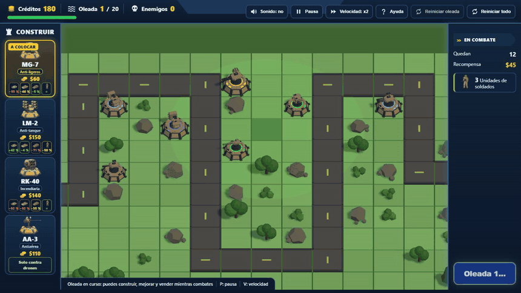

# Iron Bastion

A military 3D tower defense game for the browser, built with Three.js. Columns of vehicles and infantry squads advance along the road, with drones overhead; the player stops them with towers that aim on their own and can be upgraded and armored. The enemies shoot back: if they destroy your towers, they get through.

*[Versión en español](README.md)*

**Play:** [https://ricardomelog.github.io/iron-bastion/](https://ricardomelog.github.io/iron-bastion/)

## How to play

- **Four towers**, from the bar or with keys 1 to 4. Each has five attack levels, each with its own look, and three armor levels:
  - **MG-7** ($60): machine gun against infantry and light vehicles; at level 5, a gatling.
  - **LM-2** ($150): missile launcher against armor; fires its full magazine, then reloads.
  - **RK-40** ($140): arcing incendiary rockets; the napalm burns infantry and slows vehicles down.
  - **AA-3** ($110): anti-aircraft, drones only.
- **Twenty waves**, each heavier than the last: three-soldier squads (machine guns and RPGs), motorbikes, armed patrol vehicles, trucks that unload troops, 8x8 APCs, tanks with an active defense system that intercepts missiles, and FPV and delta-wing drones.
- **Cover:** on the road a soldier dies in one shot; on grass he dodges some bullets; behind a rock, tree or bush, part of the shots hit the cover instead. Lying prone, even more so.
- **Veterancy:** enemies that destroy towers level up and gain abilities, not just health.
- **Wheel**: zoom · **right button**: pan the map · **middle button**: rotate it · **M**: sound · **P**: pause · **V**: speed.

## The story: turrets that didn't aim

The game started with simple geometric vehicles. When it moved to 3D models from Sketchfab, each model came with its own axes, its own origin and its own turret setup. The code compensated with up to 12 per-vehicle tweaks (`assetRotation`, `pitchSign`, `turretYawOffset`…), found by trial and error, and the guns still didn't point at what they fired at. The project stalled.

The fix was not to keep tweaking models, but to define **an in-house standard** and make every model comply:

- **The standard** (`docs/asset-standard.md`): +Y up, +Z forward, origin at the center of the hull at ground level, a hull of length 1 and a fixed hierarchy (`unit_root` → `hull`, `turret_yaw` → `gun_pitch` → `muzzle_01…`) with pivots at rest.
- **The validator** (`npm run check:rigs`): turns the turret and raises the gun of every model and checks 7 rules; a model that fails doesn't get into the game.
- **A single turret code path** for every unit, and **the simulation and the rendering share the same data:** the bullet spawns at the model's muzzle and leaves along the barrel.

Measured on 2026-11-02 and afterwards, with the same tools:

| | Before | After |
|---|---|---|
| Vehicle gun when firing | off by 95° on average on the worst model | 100 % of shots within 10° (`npm run check:aim`) |
| Where the bullet spawns | at hard-coded numbers, outside the model | at the muzzle of the drawn gun, within 0.03 units |
| Per-model tweaks in code | up to 12 per vehicle | none: the boundary check forbids them |
| Production build | 62 MB | about 13 MB, with more models and sound |

## Models built in code

Third-party models were first converted to the standard with a normalizer (ADR 001), and then AI generation was tried (TRELLIS.2): the models came out as a single mesh, with jagged edges and fused parts, and touching them up didn't fix it. The decision was to **model them in code** (ADR 003): each tower, vehicle and soldier is a Python script that Blender builds (`tools/asset-pipeline/blender/`), with its moving parts and pivots defined by design. `npm run assets:code` generates and validates them.

- The tank went from 551 KB to 110 KB, with open tracks and spinning wheels.
- Rockets and missiles are separate parts: they disappear when fired and come back on reload.
- Changing a design means changing numbers and generating again.

TRELLIS.2 stayed for irregular shapes: the drones and the destroyed wrecks.

## Sound

All audio is public-domain (CC0) recordings from Freesound, picked by listening to them in an in-house lab (`tools/labs/sonidos.html`) and processed by script (`tools/audio/`): trimming, even loudness, seamless loops and, for the machine gun, a single round isolated from a burst. Every weapon, engine and explosion has its own sound, and a compressor keeps many of them at once from clipping.

## Real games and balance

The simulation runs without a browser, so a whole game can be simulated (`npm run simulate`) and measured. On top of that, every game played locally is recorded (`npm run registro`): damage by weapon and armor, accuracy, economy, enemies on screen, grenades and how much the napalm delays vehicles. Changes come from that data: the LM-2 reload, the end of the game and cover were adjusted after real games.

**In progress:** the simulator doesn't yet reproduce a person's games well, and 5 balance tests are paused until it is calibrated.

## Architecture

| Layer | Folder | What it does | May use |
|---|---|---|---|
| core | `src/core/` | Game rules without a browser: movement, aiming, firing, cover, waves | content |
| content | `src/content/` | Data: towers, enemies, waves, map, balance and each model's rig | — |
| render | `src/render/` | Three.js: scene, units, effects | core, content |
| ui | `src/ui/` | HUD and panel | core, content |
| audio | `src/audio/` | Sound player, ambience and mixing | — |
| app | `src/app/` | Wires everything and runs the loop; sound and the game recorder react to core events | all |
| tools | `tools/` | Models, sound, labs and balance strategies | all |

`npm run check:boundaries` enforces these boundaries: an import that crosses them, Three.js outside render or a per-model tweak make the check fail. More detail in `docs/architecture.md`, and the decisions in `docs/decisions/`.

## Harness

| Command | What it does |
|---|---|
| `npm run dev` | Game at `http://localhost:5173`; the labs at `/tools/labs/` |
| `npm run check` | Core tests, boundaries, model validation and build |
| `npm run check:aim` | Plays a wave in Chrome and measures the aim of every shot |
| `npm run check:dist` | Checks the production build and opens it in Chrome |
| `npm run walkthrough` | Visual walkthrough at 1440×900 and 1366×768: start, three waves, win and loss |
| `npm run simulate` | Plays the 20 waves headless with several strategies |
| `npm run registro` | Report of the last game played locally |
| `npm run assets:code` | Builds the code-made models with Blender and validates them |

Browser checks use the installed Chrome (`playwright-core`). To work on the project, start with `AGENTS.md` (in Spanish).

## Credits

- **3D models:** all are original designs. The towers, vehicles and soldiers are modeled in code in [Blender](https://www.blender.org/) (`tools/asset-pipeline/blender/`, ADR 003). The drones and the destroyed wrecks were generated with [TRELLIS.2](https://github.com/microsoft/TRELLIS.2) (MIT) from AI-made concept images.
- **Sounds:** public-domain ([CC0](https://creativecommons.org/publicdomain/zero/1.0/)) recordings from [Freesound](https://freesound.org/), trimmed and mixed for the game (`tools/audio/`).
- **The map, the effects, the synthesized sounds and the code** are the project's own.

Per-file details are in `docs/assets/ASSET_CREDITS.md`.

## License

The code and the 3D models are under the [MIT license](LICENSE); the sounds are public domain (CC0).
