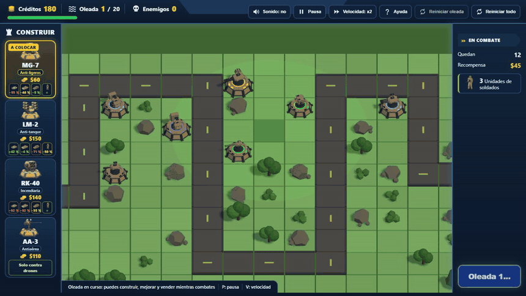

# Iron Bastion

Tower defense militar en 3D para el navegador, hecho con Three.js. Por el camino avanzan columnas de vehículos y escuadras de infantería, y desde el aire, drones; el jugador las frena con torres que apuntan solas, se mejoran y se blindan. Los enemigos también disparan: si destruyen tus torres, pasan.

*[English version](README.en.md)*

**Jugar:** [https://ricardomelog.github.io/iron-bastion/](https://ricardomelog.github.io/iron-bastion/)

## Cómo se juega

- **Cuatro torres**, en la barra o con las teclas 1 a 4. Cada una tiene cinco niveles de ataque, con aspecto propio, y tres de blindaje:
  - **MG-7** ($60): ametralladora contra infantería y vehículos ligeros; en el nivel 5, una gatling.
  - **LM-2** ($150): lanzamisiles contra blindados; dispara su cargador y recarga.
  - **RK-40** ($140): cohetes incendiarios en arco; el napalm quema la infantería y frena a los vehículos.
  - **AA-3** ($110): antiaérea, solo contra drones.
- **Veinte oleadas**, cada vez más pesadas: escuadras de tres soldados (ametralladoras y RPG), motos, patrullas armadas, camiones que sueltan tropas, blindados 8x8, tanques con defensa activa que intercepta misiles, y drones FPV y de ala delta.
- **Cobertura:** en la calle un soldado muere de un disparo; en el pasto esquiva algunas balas; tras una roca, un árbol o un arbusto, parte de los disparos le pega a la cobertura. Cuerpo a tierra, más todavía.
- **Veteranía:** los enemigos que destruyen torres suben de nivel y ganan capacidades, no solo vida.
- **Rueda**: zoom · **botón derecho**: mover el mapa · **botón central**: girarlo · **M**: sonido · **P**: pausa · **V**: velocidad.

## La historia: torretas que no apuntaban

El juego empezó con vehículos geométricos simples. Al pasar a modelos 3D de Sketchfab, cada modelo traía sus propios ejes, su propio origen y su torreta armada a su manera. El código los compensaba con hasta 12 ajustes por vehículo (`assetRotation`, `pitchSign`, `turretYawOffset`…), encontrados a prueba y error, y aun así los cañones no apuntaban a lo que disparaban. El proyecto se detuvo.

La solución no fue seguir ajustando modelos, sino definir **un estándar propio** y hacer que todo modelo lo cumpla:

- **El estándar** (`docs/asset-standard.md`): +Y arriba, +Z al frente, origen en el centro del chasis a ras del suelo, chasis de largo 1 y una jerarquía fija (`unit_root` → `hull`, `turret_yaw` → `gun_pitch` → `muzzle_01…`) con pivotes en reposo.
- **El validador** (`npm run check:rigs`): gira la torreta y eleva el cañón de cada modelo y comprueba 7 reglas; si no pasa, no entra al juego.
- **Un solo código de torreta** para todas las unidades, y **el núcleo y el dibujo usan el mismo dato:** la bala nace en la boca del modelo y sale en la dirección del cañón.

Medido el 2026-11-02 y después, con las mismas herramientas:

| | Antes | Después |
|---|---|---|
| Cañón de los vehículos al disparar | desviado 95° en promedio en el peor modelo | el 100 % de los disparos a 10° o menos (`npm run check:aim`) |
| Dónde nace la bala | en números fijos, fuera del modelo | en la boca del cañón dibujado, a 0,03 unidades o menos |
| Ajustes por modelo en el código | hasta 12 por vehículo | ninguno: el chequeo de fronteras los prohíbe |
| Build de producción | 62 MB | unos 13 MB, con más modelos y sonido |

## Modelos por código

Primero los modelos de terceros se convirtieron al estándar con un normalizador (ADR 001), y después se probó generarlos con IA (TRELLIS.2): salían como una sola malla, con bordes dentados y piezas soldadas, y retocarlos no los arreglaba. La decisión fue **modelarlos por código** (ADR 003): cada torre, vehículo y soldado es un guion de Python que Blender construye (`tools/asset-pipeline/blender/`), con sus piezas móviles y pivotes definidos desde el diseño. `npm run assets:code` los genera y los valida.

- El tanque bajó de 551 KB a 110 KB, con la oruga abierta y las ruedas que giran.
- Los cohetes y misiles son piezas propias: desaparecen al disparar y vuelven al recargar.
- Cambiar un diseño es cambiar números y volver a generar.

TRELLIS.2 quedó para lo irregular: los drones y los restos destruidos.

## Sonido

Todo el audio son grabaciones de Freesound en dominio público (CC0), elegidas escuchándolas en un laboratorio propio (`tools/labs/sonidos.html`) y procesadas por guion (`tools/audio/`): recorte, volumen parejo, bucles sin saltos y, en la ametralladora, una sola bala aislada de una ráfaga. Cada arma, motor y explosión tiene su sonido, y un compresor evita que muchos a la vez saturen.

## Partidas reales y balance

El núcleo corre sin navegador, así que una partida entera se puede simular (`npm run simulate`) y medir. Además, cada partida jugada en local queda registrada (`npm run registro`): daño por arma y blindaje, puntería, economía, enemigos a la vez, granadas y cuánto retrasa el napalm a los vehículos. Los ajustes salen de esos datos: la recarga de la LM-2, el cierre de la partida y la cobertura se cambiaron después de partidas reales.

**En curso:** el simulador todavía no reproduce bien las partidas de una persona, y 5 pruebas de balance están en pausa hasta calibrarlo.

## Arquitectura

| Capa | Carpeta | Qué hace | Puede usar |
|---|---|---|---|
| núcleo | `src/core/` | Reglas del juego sin navegador: movimiento, puntería, disparos, cobertura, oleadas | contenido |
| contenido | `src/content/` | Datos: torres, enemigos, oleadas, mapa, balance y los rigs de cada modelo | — |
| render | `src/render/` | Three.js: escena, unidades, efectos | núcleo, contenido |
| interfaz | `src/ui/` | HUD y panel | núcleo, contenido |
| audio | `src/audio/` | Reproductor de sonido, ambiente y mezcla | — |
| app | `src/app/` | Arma todo, corre el bucle; el sonido y el registro reaccionan a los eventos del núcleo | todas |
| herramientas | `tools/` | Modelos, sonido, laboratorios y estrategias de balance | todas |

`npm run check:boundaries` hace cumplir estas fronteras: un import que las cruza, Three.js fuera de render o un ajuste por modelo hacen fallar el chequeo. Más detalle en `docs/architecture.md`, y las decisiones, en `docs/decisions/`.

## Arnés

| Comando | Qué hace |
|---|---|
| `npm run dev` | Juego en `http://localhost:5173`; los laboratorios en `/tools/labs/` |
| `npm run check` | Pruebas del núcleo, fronteras, validación de modelos y build |
| `npm run check:aim` | Juega una oleada en Chrome y mide la puntería de cada disparo |
| `npm run check:dist` | Revisa el build de producción y lo abre en Chrome |
| `npm run walkthrough` | Recorrido visual a 1440×900 y 1366×768: inicio, tres oleadas, victoria y derrota |
| `npm run simulate` | Juega las 20 oleadas sin pantalla con varias estrategias |
| `npm run registro` | Informe de la última partida jugada en local |
| `npm run assets:code` | Genera los modelos por código con Blender y los valida |

Las pruebas de navegador usan el Chrome instalado (`playwright-core`). Para trabajar en el proyecto, empieza por `AGENTS.md`.

## Créditos

- **Modelos 3D:** todos son diseños propios. Las torres, los vehículos y los soldados están modelados por código en [Blender](https://www.blender.org/) (`tools/asset-pipeline/blender/`, ADR 003). Los drones y los restos destruidos se generaron con [TRELLIS.2](https://github.com/microsoft/TRELLIS.2) (MIT) desde imágenes de concepto hechas con IA.
- **Sonidos:** grabaciones de [Freesound](https://freesound.org/) en dominio público ([CC0](https://creativecommons.org/publicdomain/zero/1.0/)), recortadas y mezcladas para el juego (`tools/audio/`).
- **El mapa, los efectos, los sonidos sintetizados y el código** son del proyecto.

El detalle de cada archivo está en `docs/assets/ASSET_CREDITS.md`.

## Licencia

El código y los modelos 3D están bajo la [licencia MIT](LICENSE); los sonidos son de dominio público (CC0).
