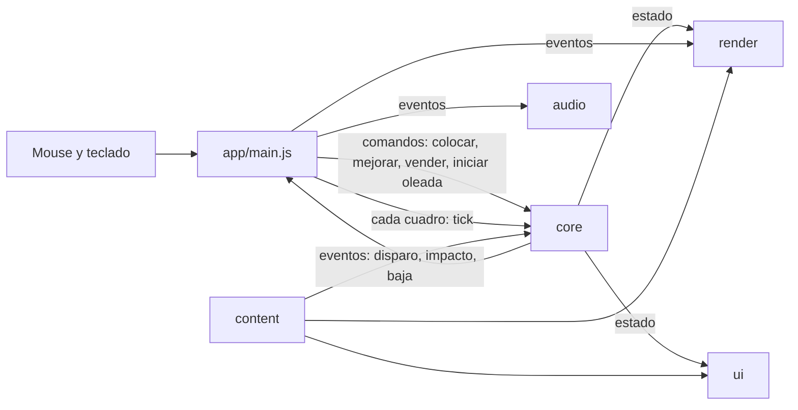

# Arquitectura

Resumen vivo de cómo está organizado el código y qué reglas están en vigor. Se actualiza en el mismo cambio que mueve una frontera. Las razones están en `docs/decisions/` (ADR 001 y ADR 002); esta página solo dice qué es cierto hoy y qué viene.

**Estado (2026-11-02):** el código ya está en sus capas (T00). El chequeo de fronteras no tiene deudas (T09). El juego dibuja todo sobre el estándar de modelos (ADR 001): los vehículos salen de `public/models/`, la MG-7 se genera por código con la misma estructura y una sola función apunta todas las torretas (T06).

## Flujo



- **El núcleo es la única fuente de verdad del juego.** Decide dónde está cada vehículo, hacia dónde apunta cada arma, cuándo dispara y qué impacta. Corre igual en el navegador y en Node, por eso `npm test` y `npm run simulate` pueden jugar sin pantalla.
- **Render dibuja el estado y no lo cambia.** Si render necesita un dato geométrico (dónde está la boca de un cañón), ese dato sale de `src/content/rigs/` y el núcleo usa el mismo (ADR 001).
- **Los eventos** (`state.effects`: `projectile-fired`, `hit`, `enemy-killed`…) los consume app en cada cuadro y los reparte a render y audio.

## Capas

| Capa | Carpeta | Contiene | Puede importar |
|---|---|---|---|
| núcleo | `src/core/` | `state.js` (estado inicial, snapshots), `simulation.js` (movimiento, objetivos, disparos, impactos, oleadas), `config.js` (arma la configuración desde el contenido), `coordinates.js` (grilla ↔ mundo), `rig-geometry.js` (de dónde sale la bala y hacia dónde apunta el cañón, con el rig de cada unidad y la convención de render), `mg7-geometry.js` (medidas de la MG-7, con las que render arma su malla), `tower-geometry.js` (tamaño de cada torre por nivel) | content |
| contenido | `src/content/` | `towers/`, `enemies/`, `waves/`, `maps/`, `gameplay.js` (balance y parámetros de simulación), `rigs/` (metadatos de cada modelo, generados por el pipeline) | content |
| render | `src/render/` | `scene-runtime.js` (escena, cámara, encuadre), un renderer por tipo de cosa (`map`, `tower`, `enemy` con los restos de los vehículos destruidos, `projectile` con el misil guiado), `units.js` (carga los modelos del estándar y tiene el único código de torreta, `aimTurret`), `tower-preview.js`, `materials.js`, `config/` (rendering, effects, framing y `palette.js`, la paleta de los vehículos que también usa el pipeline) | core, content, `three` |
| interfaz | `src/ui/` | `hud-presenter.js`, `tower-panel-presenter.js`, `layout-coordinator.js`, `layout-config.js`, `icons.js`, `styles.css` | core, content |
| audio | `src/audio/` | `sfx-player.js` (Web Audio, compresor general, silencio), `ambience-synth.js` (viento y fondo), `beep-synth.js` (cuenta regresiva), `audio-config.js` (niveles y bucles) | — |
| app | `src/app/` | `main.js`: crea todo, bucle, input, silencio (botón y tecla M), controles de desarrollo y el gancho `window.__game` (solo en dev); `audio-director.js`: el sonido, que reacciona a los eventos del núcleo; `match-recorder.js`: el registro de la partida, que `tools/match-log/` guarda en `logs/` | todas, `three` |
| herramientas | `tools/` | `labs/` (visor de rigs, laboratorio de vehículos, de la MG-7 y vista previa) y `asset-pipeline/` (`normalize.mjs`, `style.mjs`, `procedural.mjs`, `validate-rig.mjs`, `inspect.mjs`, `rig.mjs` y `manifests/`), con `gltf-transform`, `meshoptimizer` y `pngjs` | todas, `three` |
| tests | `tests/` | Pruebas del núcleo y del pipeline de modelos con `node --test`; las de la boca comparan el núcleo con la jerarquía que dibuja render, y las del registro de partidas prueban app sin navegador | core, content, render, app, tools, `three` |

Fuera de `src/`: `scripts/` (arnés), `assets/` (modelos y audio), `public/` (archivos servidos tal cual), `docs/`, `specs/`.

## Reglas en vigor

Las hace cumplir `npm run check:boundaries` (`scripts/check-boundaries.mjs`):

| Regla | Qué prohíbe | Por qué |
|---|---|---|
| `import-entre-capas` | Importar una capa no permitida en la tabla de arriba | Que cada parte se pueda cambiar sin romper las otras |
| `three-fuera-de-render` | Usar Three.js fuera de render, app, herramientas o pruebas | El núcleo y la interfaz no dependen del motor gráfico |
| `dependencia-externa` | Paquetes que no sean `three` dentro de `src/` | Cada dependencia nueva es una decisión, no un accidente |
| `core-sin-navegador` | `window`, `document`, `requestAnimationFrame` o `localStorage` en el núcleo | El núcleo tiene que correr en Node (tests y simulación) |
| `contenido-sin-assets` | Rutas a `.glb`, `.mp3`, `.png`… en el contenido | Los datos de juego no saben cómo se dibujan; eso es de render |
| `sin-calibracion-por-modelo` | `assetRotation`, `pitchAxis`, `turretYawOffset` y los demás ajustes por modelo | ADR 001: los modelos llegan normalizados |
| `capa-desconocida` | Carpetas nuevas en `src/` que no sean una capa | Una capa nueva se decide y se documenta aquí |

**Trinquete.** La deuda que ya existía está en `scripts/checks/known-violations.json`. El chequeo falla si aparece una violación nueva y también si una conocida se resolvió pero sigue en la lista.

**Dueños del layout** (auditoría de marzo, `docs/history/2026-03-ui-layout-audit.md`): la posición del panel y del canvas se ajusta solo en `src/ui/layout-config.js`, y el encuadre de la cámara solo en `src/render/config/framing.js`.

## Deuda

No hay deuda declarada (2026-11-02). El chequeo de fronteras no tiene excepciones (CA-9) y `npm run check:dist` comprueba que el build lleva solo el juego (CA-6).

## Destino de los modelos (ADR 001)

```
assets/source/<archivo original>.glb        modelo de terceros, sin tocar, con su licencia
tools/asset-pipeline/manifests/<id>.json    frente, arriba, qué nodo es la torreta, cuál el cañón y sus bocas
        │  npm run assets:normalize
        ▼
public/models/<id>.glb                      modelo con la estructura del estándar
src/content/rigs/<id>.json                  bocas, pivotes y radio, en coordenadas del modelo
        │  npm run check:rigs (falla si el modelo no cumple el contrato)
        ▼
/tools/labs/rig-viewer.html                 se mira: la dirección de cada boca sale por el cañón
        │
        ▼
src/content/enemies/                        cada tipo de enemigo nombra su rig y su largo (model.rig y model.scale)
src/render/units.js                         carga el modelo y apunta la torreta con aimTurret, igual para todos
```

Las torres que vienen de un `.glb`, como la LM-2, siguen el mismo camino que los vehículos (`TowerRenderer.buildMesh` las carga con `units.js`). Los modelos generados con IA llegan como una sola malla y el normalizador los parte por volúmenes antes de todo lo demás (`tools/asset-pipeline/split.mjs`).

La MG-7 no pasa por este camino: se genera por código (`buildTowerUnit` en `src/render/tower-renderer.js`) ya con la estructura del estándar. `tools/asset-pipeline/procedural.mjs` la arma en memoria, `assets:normalize` escribe su `src/content/rigs/mg7-lvl<N>.json` y `check:rigs` le aplica las mismas 7 reglas.

El núcleo lee `src/content/rigs/` para saber de dónde sale cada bala; render lee el mismo archivo y el `.glb`. Ningún archivo del juego guarda ajustes de un modelo en particular.
